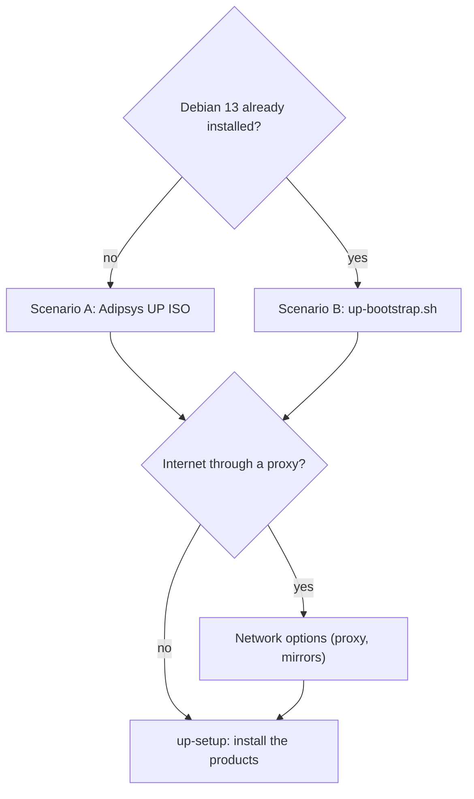

# Adipsys UP — Installation and update guide

*[Version française](../guide-installation.md)*

This guide explains how to install an Adipsys UP server, deploy Adipsys products on it and keep them up to date, without help from support in common cases.

For the simplest case (one server, ISO, direct Internet access), the [quick start](quick-start.md) is enough.

The server tools (`up-setup`, `up-update`) and their messages are in French; this guide quotes them in French with their meaning.

## Contents

- [Choose your scenario](#choose-your-scenario)
- [Requirements](#requirements)
- [Scenario A: install from the Adipsys UP ISO](#scenario-a-install-from-the-adipsys-up-iso)
- [Scenario B: prepare an existing Debian 13](#scenario-b-prepare-an-existing-debian-13)
- [Corporate network: proxy and internal mirrors](#corporate-network-proxy-and-internal-mirrors)
- [Install the products with the up-setup wizard](#install-the-products-with-the-up-setup-wizard)
- [HTTPS certificates](#https-certificates)
- [Updates](#updates)
- [Backups and restore](#backups-and-restore)
- [Troubleshooting](#troubleshooting)

## Choose your scenario



Both paths (A and B) lead to the same server. Behind a proxy, add the network options, then run `up-setup`.

## Requirements

A Debian 13 VM (VMware or Proxmox recommended), Internet access (direct or through a proxy), and the products' DNS names are all you need. The licence server must be reachable: this is mandatory.

### VM resources

| Use | vCPU | RAM | Disk |
|---|---|---|---|
| Hotspot Manager only | 4 | 4 GB | 100 GB SSD |
| DNS Protect | 4 | 8 GB | 100 GB SSD |
| Several products | 8 | 16 GB | 100 GB SSD |

On Proxmox, tick *QEMU Guest Agent* in the VM options. On VMware, nothing to do: the agent is installed.

### Outbound traffic to allow

| Destination | Port | Use |
|---|---|---|
| licences.adipsys.com | 443/tcp | Licences (mandatory) |
| registry.adipsys.com | 443/tcp | Adipsys product images |
| Docker Hub (registry-1.docker.io and its CDNs) | 443/tcp | Portainer, Traefik, technical images |
| raw.githubusercontent.com, github.com | 443/tcp | UP templates and tools |
| deb.debian.org, security.debian.org | 80/tcp, 443/tcp | Debian packages and updates |
| download.docker.com | 443/tcp | Docker packages |
| NTP servers | 123/udp | Server time |

If this traffic goes through a proxy or internal mirrors, see [Corporate network](#corporate-network-proxy-and-internal-mirrors).

### Inbound traffic

| Product | Ports |
|---|---|
| All | 443/tcp (HTTPS); 80/tcp (redirect, portal, Let's Encrypt validation) |
| Hotspot Manager | 1812/udp, 1813/udp (Radius, from the controller); 3799/udp (CoA); 514/udp (legal logs) |
| DNS Protect | 53/udp (DNS) |
| rSyslog | 514/udp (logs) |
| Adipsys support (178.33.43.243) | 22/tcp (SSH), 9443/tcp (Portainer), plus the product ports |

### To prepare

- The ISO download link and its password, provided by Adipsys (scenario A).
- The Adipsys registry credentials, provided by Adipsys (scenario B; the ISO already contains them).
- Your company name, without spaces or special characters (e.g. `MyCompany`).
- Your domain and the names to create (e.g. for Hotspot Manager: `wifi.domain.com`, `wifi-admin.domain.com`, `wifi-api.domain.com`).
- Your company's support e-mail address.
- A certificate for these names, or port 80 reachable from the Internet for Let's Encrypt.
- For Hotspot Manager: the superadmin account and licence key provided by Adipsys.

## Scenario A: install from the Adipsys UP ISO

The ISO installs Debian 13, then prepares the server automatically (Docker, Swarm, Portainer, backups). Allow 15 to 30 minutes.

1. Download `Adipsys_UP_trixie.iso` with the link and password provided by Adipsys. The file `Adipsys_UP_trixie.iso.sha256` lets you check the download:

   ```bash
   sha256sum -c Adipsys_UP_trixie.iso.sha256
   ```

2. Create the VM (see [Requirements](#requirements)) and boot it from the ISO. BIOS and UEFI boot are supported; the ISO can also be copied to a USB stick.
3. Answer the Debian installer's questions: language, keyboard, network (fixed IP recommended), server name, root password, partitioning.
4. If the server reaches the Internet through a proxy, enter it at the *HTTP proxy* question (e.g. `http://proxy.company.com:3128`). It will be reused for Docker, Portainer and the products.
5. At the end of the installation, the server prepares itself, then reboots. On first boot, it starts Portainer and creates the Swarm; it waits up to 10 minutes for the network.
6. Log in as root (console or SSH). The welcome message shows the ISO version and the next step: run `up-setup` (see [Install the products](#install-the-products-with-the-up-setup-wizard)).

If the welcome message shows « INSTALLATION INCOMPLÈTE » (installation incomplete), see [Troubleshooting](#troubleshooting).

## Scenario B: prepare an existing Debian 13

On an already installed Debian 13 (VM from your catalogue, cloud), the `up-bootstrap.sh` script produces the same server as the ISO.

Conditions: Debian 13 (trixie) amd64, no desktop environment, no Docker installed outside the official repository, root access.

1. Download and run the script:

   ```bash
   curl -fsSL https://raw.githubusercontent.com/Adipsys/public/main/bootstrap/up-bootstrap.sh -o up-bootstrap.sh
   sudo bash up-bootstrap.sh
   ```

2. Behind a proxy, add its options (see [Corporate network](#corporate-network-proxy-and-internal-mirrors)); if `curl` itself cannot get through, add `-x http://proxy:3128` to the first command.
3. At the end, the script starts Portainer and the Swarm immediately, without rebooting. Then run `up-setup`.

The script refuses any system other than Debian 13; the `--force` option overrides this, without guarantee. It can be run again safely. Log: `/var/log/up-bootstrap.log`.

## Corporate network: proxy and internal mirrors

Without direct Internet access, the server can send everything through a proxy and download images from your internal mirrors. The licence server is still mandatory: it must be reachable, at least through the proxy.

- **ISO**: the proxy entered at the *HTTP proxy* question is reused automatically.
- **Existing Debian, or to change the settings**: run `up-bootstrap.sh` again with the options you need. It is installed on the server in `/usr/local/bin/public/bootstrap/`.

```bash
sudo bash /usr/local/bin/public/bootstrap/up-bootstrap.sh \
    --proxy http://proxy.company.com:3128 \
    --no-proxy "intra.company.com,10.0.0.0/8" \
    --dockerhub-mirror https://nexus.company.com:8443 \
    --adipsys-registry harbor.company.com/adipsys
```

| Option | Effect |
|---|---|
| `--proxy URL` | Proxy for packages, Docker, Portainer and the products (licences, external APIs). `--proxy none` removes it. |
| `--no-proxy LIST` | Destinations reached without the proxy, comma-separated. `localhost` and `127.0.0.1` are always added. |
| `--dockerhub-mirror URL` | Internal Docker Hub mirror (Nexus, Harbor…). |
| `--adipsys-registry PATH` | Internal registry replicating `registry.adipsys.com` (e.g. a Harbor proxy-cache project). |

The settings are saved in `/etc/up/up.conf` and reused by the `up-setup` wizard and by updates. Products already installed keep their previous setting: in Portainer, edit the `HTTP_PROXY`, `HTTPS_PROXY` and `NO_PROXY` variables of their stack, then *Update the stack*.

A fully isolated server, with no access at all to the licence server, is not supported.

## Install the products with the up-setup wizard

The `up-setup` wizard installs Hotspot Manager, DNS Protect and STUDIO, asking only the questions that matter. Hotspot Manager includes its own rSyslog; a standalone rSyslog, for a server without Hotspot Manager, is installed from Portainer (*App Templates* → *rSyslog*). Run it as root on the server:

```bash
up-setup
```

It updates itself at startup, can be interrupted and run again at any time, and goes through these steps:

1. **Checks**: if the machine name is generic ("unassigned", "debian"…), the wizard asks for a real name, which identifies the server for Adipsys support. Then VM resources, access to the licence server, the Adipsys registry, Docker Hub, GitHub and Debian, time synchronisation. Anything blocked is reported before going further.
2. **Portainer**: creates the administrator account with a generated password.
3. **Adipsys registry**: credentials taken from the ISO, or entered then checked before being saved.
4. **Traefik**: installs the reverse proxy shared by all products.
5. **Products**: tick the ones to install, then answer for each (company, server name, domain, support e-mail, Let's Encrypt or not). Passwords are generated, DNS names checked, and a product whose ports are already in use on the server is not installed.
6. **Summary**: administration addresses, DNS names to create, ports to open and remaining steps.

Running `up-setup` again on a server where a product is already installed does not change that product: it can be used to add another product later.

Files created, readable by root only:

| File | Content |
|---|---|
| `/root/up-install-report.txt` | Installation summary, to send to support if needed |
| `/root/up-secrets.env` | Generated passwords (Portainer, databases) |
| `/root/.up-update.conf` | Portainer API key used by updates |
| `/var/log/up-setup.log` | Wizard log |

Keep the content of `/root/up-secrets.env` in your password vault.

### After the wizard

- Create the DNS records listed in the summary, pointing to the server's IP.
- Open the inbound ports listed for each product.
- Hotspot Manager: log in from the final DNS name with the superadmin account provided by Adipsys, enter the licence key, change the password and configure the SMTP server.
- Portainer remains available at `https://<server IP>:9443` to check the state of the products.

### Without the wizard (Portainer)

Products can also be installed from Portainer, *App Templates* menu: always install Traefik first, then the product, and fill in the form. Without Traefik, the installation fails with the error `network "traefik_default" is declared as external, but could not be found`.

## HTTPS certificates

Two choices per product: Let's Encrypt, free and renewed automatically, or your company's certificate.

|  | Let's Encrypt | Company certificate |
|---|---|---|
| Conditions | Public DNS names pointing to the server; port 80 reachable from the Internet | A certificate and its key covering the product's names |
| Setup | Answer *Oui* (yes) to the `up-setup` question, or add the variable `TLS_RESOLVER=letsencrypt` to the stack, then *Update the stack* | Put the files in `/root/ssl_certificates/` and declare them in `/root/traefik/traefik.yaml` |
| Renewal | Automatic | Your responsibility, before expiry |

Example declaration in `/root/traefik/traefik.yaml`:

```yaml
tls:
  certificates:
    - certFile: /root/ssl_certificates/domain.com.bun
      keyFile: /root/ssl_certificates/domain.com.key
```

Administration interfaces are redirected from HTTP to HTTPS. The Hotspot Manager captive portal and API also remain available over HTTP.

### Renew the company certificate

The new certificate is used as soon as `/root/traefik/traefik.yaml` is saved, without restart or downtime.

1. Log in over SSH and locate the current files:

   ```bash
   cat /root/traefik/traefik.yaml
   ```

2. Copy the new key to `/root/ssl_certificates/`, under a new name (e.g. `domain.com-2026.key`).
3. Create the new `.bun` file: the new certificate (`.crt`), followed in the same file by the intermediate certificate provided by your certificate authority:

   ```bash
   cat domain.com.crt intermediate.crt > /root/ssl_certificates/domain.com-2026.bun
   ```

4. Change `certFile` and `keyFile` in `/root/traefik/traefik.yaml` to point to the new files, then save.
5. Open the product's addresses in a browser and check the expiry date. A test on [SSL Labs](https://www.ssllabs.com/ssltest/) is recommended.

Keeping the old certificate under its own name lets you roll back by restoring the old paths. Restarting Traefik is normally not needed; if the certificate is not picked up: `docker restart $(docker ps -q -f name=traefik)`.

## Updates

Three things are updated separately: Adipsys products (on demand), Portainer (on demand) and Debian (automatically, security fixes).

### Adipsys products

When a new version starts, the database is migrated automatically, with no way back: returning to the previous version requires restoring the pre-update backup. Take a VM snapshot before the operation.

```bash
up-update -l                              # installed products and versions
up-update -s hotspotmanager -v 3.41.3     # update
```

Like `up-setup`, `up-update` updates itself each time it starts. The command:

1. checks that the requested version is newer than the installed one (downgrades are refused: they go through support), that the product is running and that at least 1 GB is free, then downloads the new version's images: a version that does not exist is refused before any service interruption;
2. backs up the database and data to `/backups/pre-update/` (last 3 backups kept per product);
3. changes the version in Portainer;
4. waits up to 15 minutes for all services to restart, for the product to finish starting (database migration included) and for the login page to respond;
5. checks the service logs: an unfinished migration or error lines are reported. The logs are copied to the backup folder (`logs/`).

If the update fails, or errors appear in the logs, the command shows the relevant details and asks you to contact Adipsys support ([support@adipsys.com](mailto:support@adipsys.com)), giving the backup folder. Do not try to return to the previous version yourself: rolling back erases the data written since the update, so it is done with support.

Without `up-update`, the update can also be done in Portainer: stack → *Editor* → variable `PRODUCT_VERSION` → *Update the stack*, after backing up the database.

The version number to use is given by Adipsys.

### Portainer

```bash
/usr/local/bin/public/up-tools/portainer-update.sh
```

The script downloads the latest version, keeps the data and configuration, and restarts the previous version if the new one does not start. The products keep running during the operation.

### Debian system

Debian security fixes are installed every night, without automatic reboot. Docker is excluded, because updating it restarts all products. When a reboot is needed, the file `/var/run/reboot-required` exists: schedule it in a maintenance window.

To update Docker and the rest of the system, during maintenance: `apt update && apt full-upgrade`, then reboot if asked.

## Backups and restore

Every night the server backs up its state and databases to `/backups/`, with 30 days of retention. These backups stay on the server: copy them elsewhere (network share, VM backup tool), otherwise they disappear with it.

| Time | Content | Folder |
|---|---|---|
| 00:00 | Docker Swarm state | `/backups/docker-engine/` |
| 00:05 | Portainer data | `/backups/docker-volumes/` |
| 00:15 | Product databases | `/backups/docker-db/` |
| On each `up-update` | Database and data of the updated product | `/backups/pre-update/` |

For any restore, including after a failed update, contact Adipsys support ([support@adipsys.com](mailto:support@adipsys.com)): a restore erases data newer than the backup.

A VM snapshot before each operation remains the simplest protection.

## Troubleshooting

Most failures come from blocked network access: run `up-setup` again, its first step lists what cannot be reached.

| Symptom | Likely cause | What to do |
|---|---|---|
| The welcome message shows « INSTALLATION INCOMPLÈTE » | Server preparation stopped on an error | Read the failed step in `/var/lib/up/bootstrap.failed` and the details in `/var/log/up-bootstrap.log`, fix it (network, proxy), then run `bash /usr/local/bin/public/bootstrap/up-bootstrap.sh` again |
| Portainer does not answer on port 9443 after first boot | No access to Docker Hub at first boot; the service retries every 5 minutes | `systemctl status up-firstboot` and `journalctl -u up-firstboot`; check the proxy or Docker Hub mirror |
| `up-setup` stops: « impossible de créer le compte administrateur Portainer » (cannot create the Portainer administrator account) | Tools not up to date for a recent Portainer version (setup token), or server without access to GitHub | Run `up-setup` again (it updates itself); details in `/var/log/up-setup.log` |
| `up-setup` reports blocked access | Firewall or proxy | Open the traffic listed in [Requirements](#requirements), or configure the proxy (see [Corporate network](#corporate-network-proxy-and-internal-mirrors)) |
| Registry credentials rejected | Wrong credentials or registry unreachable | Check the credentials provided by Adipsys and access to `registry.adipsys.com` |
| A product does not start | Image not downloaded, insufficient resources | Portainer → *Stacks* → the product → service state and logs |
| Error « traefik_default … could not be found » | Traefik not installed | Install the Traefik template, then the product |
| Let's Encrypt certificate not obtained | Missing DNS name or port 80 closed from the Internet | Check DNS and port 80, then read the Traefik service logs |
| Time not synchronised | Port 123/udp blocked | Allow NTP or set an internal NTP server |

### Contact support

Write to [support@adipsys.com](mailto:support@adipsys.com) describing the problem, with the following:

- The file `/root/up-install-report.txt` (contains no passwords).
- The server version: `cat /etc/up-release`.
- The relevant logs: `/var/log/up-bootstrap.log`, `/var/log/up-setup.log`, `/var/log/up-update.log`.

Never send the file `/root/up-secrets.env`.
