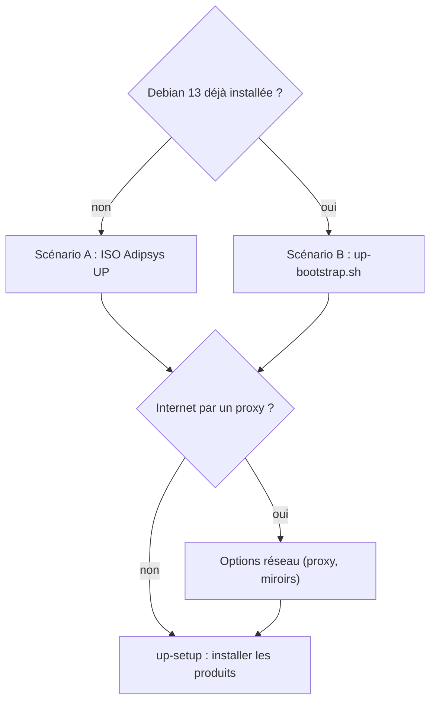

# Adipsys UP — Guide d'installation et de mise à jour

*[English version](en/installation-guide.md)*

Ce guide permet d'installer un serveur Adipsys UP, d'y déployer les produits Adipsys et de les maintenir à jour, sans intervention du support dans les cas courants.

Pour le cas le plus simple (un serveur, ISO, accès direct à Internet), le [démarrage rapide](demarrage-rapide.md) suffit.

## Sommaire

- [Choisir son scénario](#choisir-son-scénario)
- [Prérequis](#prérequis)
- [Scénario A : installer depuis l'ISO Adipsys UP](#scénario-a--installer-depuis-liso-adipsys-up)
- [Scénario B : préparer une Debian 13 existante](#scénario-b--préparer-une-debian-13-existante)
- [Réseau d'entreprise : proxy et miroirs internes](#réseau-dentreprise--proxy-et-miroirs-internes)
- [Installer les produits avec l'assistant up-setup](#installer-les-produits-avec-lassistant-up-setup)
- [Certificats HTTPS](#certificats-https)
- [Mettre à jour](#mettre-à-jour)
- [Sauvegardes et restauration](#sauvegardes-et-restauration)
- [Dépannage](#dépannage)

## Choisir son scénario



Les deux chemins (A et B) aboutissent au même serveur. Derrière un proxy, ajoutez les options réseau, puis lancez `up-setup`.

## Prérequis

Une VM Debian 13 (VMware ou Proxmox conseillés), un accès à Internet direct ou par proxy, et les noms DNS des produits suffisent. Le serveur de licences doit être joignable : c'est obligatoire.

### Ressources de la VM

| Usage | vCPU | RAM | Disque |
|---|---|---|---|
| Hotspot Manager seul | 4 | 4 Go | 100 Go SSD |
| DNS Protect | 4 | 8 Go | 100 Go SSD |
| Plusieurs produits | 8 | 16 Go | 100 Go SSD |

Sous Proxmox, cocher *QEMU Guest Agent* dans les options de la VM. Sous VMware, rien à faire : l'agent est installé.

### Flux sortants à autoriser

| Destination | Port | Usage |
|---|---|---|
| licences.adipsys.com | 443/tcp | Licences (obligatoire) |
| registry.adipsys.com | 443/tcp | Images des produits Adipsys |
| Docker Hub (registry-1.docker.io et ses CDN) | 443/tcp | Portainer, Traefik, images techniques |
| raw.githubusercontent.com, github.com | 443/tcp | Templates et outils UP |
| deb.debian.org, security.debian.org | 80/tcp, 443/tcp | Paquets et mises à jour Debian |
| download.docker.com | 443/tcp | Paquets Docker |
| Serveurs NTP | 123/udp | Heure du serveur |

Si ces flux passent par un proxy ou des miroirs internes, voir la section [Réseau d'entreprise](#réseau-dentreprise--proxy-et-miroirs-internes).

### Flux entrants

| Produit | Ports |
|---|---|
| Tous | 443/tcp (HTTPS) ; 80/tcp (redirection, portail, validation Let's Encrypt) |
| Hotspot Manager | 1812/udp, 1813/udp (Radius, depuis le contrôleur) ; 3799/udp (CoA) ; 514/udp (logs légaux) |
| DNS Protect | 53/udp (DNS) |
| rSyslog | 514/udp (logs) |
| Support Adipsys (178.33.43.243) | 22/tcp (SSH), 9443/tcp (Portainer), plus les ports des produits |

### À préparer

- Le lien de téléchargement de l'ISO et son mot de passe, fournis par Adipsys (scénario A).
- Les identifiants du registre Adipsys, fournis par Adipsys (scénario B ; l'ISO les contient déjà).
- Le nom de votre société, sans espace ni caractère spécial (ex. : `MaSociete`).
- Votre domaine et les noms à créer (ex. pour Hotspot Manager : `wifi.domaine.fr`, `wifi-admin.domaine.fr`, `wifi-api.domaine.fr`).
- L'adresse e-mail du support de votre société.
- Un certificat pour ces noms, ou un accès au port 80 depuis Internet pour Let's Encrypt.
- Pour Hotspot Manager : le compte superadmin et la clé de licence fournis par Adipsys.

## Scénario A : installer depuis l'ISO Adipsys UP

L'ISO installe Debian 13 puis prépare automatiquement le serveur (Docker, Swarm, Portainer, sauvegardes). Comptez 15 à 30 minutes.

1. Téléchargez `Adipsys_UP_trixie.iso` avec le lien et le mot de passe fournis par Adipsys. Le fichier `Adipsys_UP_trixie.iso.sha256` permet de vérifier le téléchargement :

   ```bash
   sha256sum -c Adipsys_UP_trixie.iso.sha256
   ```

2. Créez la VM (voir [Prérequis](#prérequis)) et démarrez-la sur l'ISO. Le démarrage BIOS et UEFI sont pris en charge ; l'ISO peut aussi être copiée sur une clé USB.
3. Répondez aux questions de l'installateur Debian : langue, clavier, réseau (IP fixe conseillée), nom du serveur, mot de passe root, partitionnement.
4. Si le serveur sort sur Internet par un proxy, saisissez-le à la question *Mandataire HTTP* (ex. : `http://proxy.client.fr:3128`). Il sera repris pour Docker, Portainer et les produits.
5. À la fin de l'installation, le serveur se prépare puis redémarre. Au premier démarrage, il lance Portainer et crée le Swarm ; il attend le réseau jusqu'à 10 minutes.
6. Connectez-vous en root (console ou SSH). Le message d'accueil affiche la version de l'ISO et rappelle la suite : lancez `up-setup` (section [Installer les produits](#installer-les-produits-avec-lassistant-up-setup)).

Si le message d'accueil affiche « INSTALLATION INCOMPLÈTE », voir la section [Dépannage](#dépannage).

## Scénario B : préparer une Debian 13 existante

Sur une Debian 13 déjà installée (VM de votre catalogue, cloud), le script `up-bootstrap.sh` produit le même serveur que l'ISO.

Conditions : Debian 13 (trixie) amd64, sans environnement graphique, sans Docker installé hors dépôt officiel, avec un accès root.

1. Téléchargez et lancez le script :

   ```bash
   curl -fsSL https://raw.githubusercontent.com/Adipsys/public/main/bootstrap/up-bootstrap.sh -o up-bootstrap.sh
   sudo bash up-bootstrap.sh
   ```

2. Derrière un proxy, ajoutez ses options (section [Réseau d'entreprise](#réseau-dentreprise--proxy-et-miroirs-internes)) ; si `curl` lui-même ne passe pas, ajoutez `-x http://proxy:3128` à la première commande.
3. À la fin, le script démarre Portainer et le Swarm immédiatement, sans redémarrage. Lancez ensuite `up-setup`.

Le script refuse un autre système que Debian 13 ; l'option `--force` passe outre, sans garantie. Il peut être relancé sans risque. Journal : `/var/log/up-bootstrap.log`.

## Réseau d'entreprise : proxy et miroirs internes

Sans accès direct à Internet, le serveur peut tout faire passer par un proxy et télécharger les images depuis vos miroirs internes. Le serveur de licences reste obligatoire : il doit être joignable, au moins par le proxy.

- **ISO** : le proxy saisi à la question *Mandataire HTTP* est repris automatiquement.
- **Debian existante, ou pour modifier les réglages** : relancez `up-bootstrap.sh` avec les options voulues. Il est installé sur le serveur dans `/usr/local/bin/public/bootstrap/`.

```bash
sudo bash /usr/local/bin/public/bootstrap/up-bootstrap.sh \
    --proxy http://proxy.client.fr:3128 \
    --no-proxy "intra.client.fr,10.0.0.0/8" \
    --dockerhub-mirror https://nexus.client.fr:8443 \
    --adipsys-registry harbor.client.fr/adipsys
```

| Option | Effet |
|---|---|
| `--proxy URL` | Proxy pour les paquets, Docker, Portainer et les produits (licences, API externes). `--proxy none` le retire. |
| `--no-proxy LISTE` | Destinations jointes sans proxy, séparées par des virgules. `localhost` et `127.0.0.1` sont toujours ajoutés. |
| `--dockerhub-mirror URL` | Miroir interne de Docker Hub (Nexus, Harbor…). |
| `--adipsys-registry CHEMIN` | Registre interne qui réplique `registry.adipsys.com` (ex. projet proxy-cache Harbor). |

Les réglages sont enregistrés dans `/etc/up/up.conf` et repris par l'assistant `up-setup` et par les mises à jour. Les produits déjà installés gardent leur ancien réglage : dans Portainer, modifiez les variables `HTTP_PROXY`, `HTTPS_PROXY` et `NO_PROXY` de leur stack, puis *Update the stack*.

Un serveur totalement isolé, sans aucun accès au serveur de licences, n'est pas pris en charge.

## Installer les produits avec l'assistant up-setup

L'assistant `up-setup` installe Hotspot Manager, DNS Protect, STUDIO et rSyslog en posant seulement les questions utiles. Lancez-le en root sur le serveur :

```bash
up-setup
```

Il se met à jour seul au démarrage, peut être interrompu et relancé à tout moment, et enchaîne ces étapes :

1. **Vérifications** : ressources de la VM, accès aux licences, au registre Adipsys, à Docker Hub, à GitHub et à Debian, heure synchronisée. Ce qui est bloqué est signalé avant d'aller plus loin.
2. **Portainer** : création du compte administrateur avec un mot de passe généré.
3. **Registre Adipsys** : identifiants repris de l'ISO, ou saisis puis vérifiés avant enregistrement.
4. **Traefik** : installation du reverse proxy commun à tous les produits.
5. **Produits** : cochez ceux à installer, puis répondez pour chacun (société, nom du serveur, domaine, e-mail du support, Let's Encrypt ou non). Les mots de passe sont générés et les noms DNS vérifiés.
6. **Récapitulatif** : adresses d'administration, noms DNS à créer, ports à ouvrir et étapes restantes.

Relancer `up-setup` sur un serveur où un produit est déjà installé ne modifie pas ce produit : cela permet d'ajouter un autre produit plus tard.

Fichiers créés, lisibles par root uniquement :

| Fichier | Contenu |
|---|---|
| `/root/up-install-report.txt` | Récapitulatif de l'installation, à transmettre au support si besoin |
| `/root/up-secrets.env` | Mots de passe générés (Portainer, bases de données) |
| `/root/.up-update.conf` | Clé d'API Portainer utilisée par les mises à jour |
| `/var/log/up-setup.log` | Journal de l'assistant |

Conservez le contenu de `/root/up-secrets.env` dans votre coffre-fort de mots de passe.

### Après l'assistant

- Créez les enregistrements DNS indiqués dans le récapitulatif, vers l'IP du serveur.
- Ouvrez les ports entrants listés pour chaque produit.
- Hotspot Manager : connectez-vous avec le compte superadmin fourni par Adipsys depuis le nom DNS définitif, saisissez la clé de licence, changez le mot de passe et configurez le serveur SMTP.
- Portainer reste accessible sur `https://<IP du serveur>:9443` pour consulter l'état des produits.

### Sans l'assistant (Portainer)

Les produits peuvent aussi s'installer depuis Portainer, menu *App Templates* : installez toujours Traefik en premier, puis le produit, et remplissez le formulaire. Sans Traefik, l'installation échoue avec l'erreur `network "traefik_default" is declared as external, but could not be found`.

## Certificats HTTPS

Deux choix par produit : Let's Encrypt, gratuit et renouvelé seul, ou le certificat de votre entreprise.

|  | Let's Encrypt | Certificat de l'entreprise |
|---|---|---|
| Conditions | Noms DNS publics vers le serveur ; port 80 joignable depuis Internet | Un certificat et sa clé couvrant les noms du produit |
| Mise en place | Répondre *Oui* à la question de `up-setup`, ou ajouter la variable `TLS_RESOLVER=letsencrypt` à la stack puis *Update the stack* | Déposer les fichiers dans `/root/ssl_certificates/` et les déclarer dans `/root/traefik/traefik.yaml` |
| Renouvellement | Automatique | À votre charge, avant expiration |

Exemple de déclaration dans `/root/traefik/traefik.yaml` :

```yaml
tls:
  certificates:
    - certFile: /root/ssl_certificates/domaine.fr.bun
      keyFile: /root/ssl_certificates/domaine.fr.key
```

Les interfaces d'administration sont redirigées de HTTP vers HTTPS. Le portail captif et l'API Hotspot Manager restent aussi accessibles en HTTP.

### Renouveler le certificat de l'entreprise

Le nouveau certificat est pris en compte dès que `/root/traefik/traefik.yaml` est enregistré, sans redémarrage ni coupure.

1. Connectez-vous en SSH et repérez les fichiers actuels :

   ```bash
   cat /root/traefik/traefik.yaml
   ```

2. Copiez la nouvelle clé dans `/root/ssl_certificates/`, sous un nouveau nom (ex. : `domaine.fr-2026.key`).
3. Créez le nouveau fichier `.bun` : le nouveau certificat (`.crt`), suivi dans le même fichier du certificat intermédiaire fourni par votre autorité de certification :

   ```bash
   cat domaine.fr.crt intermediaire.crt > /root/ssl_certificates/domaine.fr-2026.bun
   ```

4. Modifiez `certFile` et `keyFile` dans `/root/traefik/traefik.yaml` pour viser les nouveaux fichiers, puis enregistrez.
5. Ouvrez les adresses du produit dans un navigateur et vérifiez la date d'expiration. Un test sur [SSL Labs](https://www.ssllabs.com/ssltest/) est conseillé.

Garder l'ancien certificat sous son nom permet de revenir en arrière en rétablissant les anciens chemins. Le redémarrage de Traefik n'est normalement pas nécessaire ; si le certificat n'est pas pris en compte : `docker restart $(docker ps -q -f name=traefik)`.

## Mettre à jour

Trois choses se mettent à jour séparément : les produits Adipsys (à la demande), Portainer (à la demande) et Debian (automatiquement, correctifs de sécurité).

### Produits Adipsys

Au démarrage d'une nouvelle version, la base de données est migrée automatiquement, sans retour arrière possible : revenir à l'ancienne version impose de restaurer la sauvegarde d'avant la mise à jour. Faites un snapshot de la VM avant l'opération.

```bash
up-update -l                              # produits installés et versions
up-update -s hotspotmanager -v 3.41.3     # mise à jour
```

Comme `up-setup`, `up-update` se met à jour seul à chaque lancement. La commande :

1. vérifie que la version demandée est plus récente que celle installée (la descente de version est refusée : elle passe par le support), que le produit fonctionne et qu'il reste au moins 1 Go libre, puis télécharge les images de la nouvelle version : une version qui n'existe pas est refusée avant toute coupure du service ;
2. sauvegarde la base et les données dans `/backups/pre-update/` (3 dernières sauvegardes gardées par produit) ;
3. change la version dans Portainer ;
4. attend jusqu'à 15 minutes que tous les services aient redémarré, que le produit ait terminé son démarrage (migration de la base comprise) et que la page de connexion réponde ;
5. contrôle les logs des services : une migration non terminée ou des lignes d'erreur sont signalées. Les logs sont copiés dans le dossier de sauvegarde (`logs/`).

En cas d'échec, ou d'erreurs dans les logs, la commande affiche les éléments utiles et vous invite à contacter le support Adipsys ([support@adipsys.com](mailto:support@adipsys.com)) en indiquant le dossier de sauvegarde. Ne tentez pas de revenir vous-même à l'ancienne version : le retour arrière efface les données écrites depuis la mise à jour, il est réalisé avec le support.

Sans `up-update`, la mise à jour se fait aussi dans Portainer : stack → *Editor* → variable `PRODUCT_VERSION` → *Update the stack*, après une sauvegarde de la base.

Le numéro de version à utiliser est communiqué par Adipsys.

### Portainer

```bash
/usr/local/bin/public/up-tools/portainer-update.sh
```

Le script télécharge la dernière version, garde les données et la configuration, et relance l'ancienne version si la nouvelle ne démarre pas. Les produits continuent de fonctionner pendant l'opération.

### Système Debian

Les correctifs de sécurité Debian s'installent chaque nuit, sans redémarrage automatique. Docker en est exclu, car sa mise à jour redémarre tous les produits. Quand un redémarrage est nécessaire, le fichier `/var/run/reboot-required` existe : planifiez-le dans une fenêtre de maintenance.

Pour mettre à jour Docker et le reste du système, en maintenance : `apt update && apt full-upgrade`, puis redémarrez si demandé.

## Sauvegardes et restauration

Le serveur sauvegarde chaque nuit son état et ses bases dans `/backups/`, avec 30 jours de rétention. Ces sauvegardes restent sur le serveur : copiez-les ailleurs (partage réseau, outil de sauvegarde de la VM), sinon elles disparaissent avec lui.

| Heure | Contenu | Dossier |
|---|---|---|
| 00:00 | État de Docker Swarm | `/backups/docker-engine/` |
| 00:05 | Données Portainer | `/backups/docker-volumes/` |
| 00:15 | Bases de données des produits | `/backups/docker-db/` |
| À chaque `up-update` | Base et données du produit mis à jour | `/backups/pre-update/` |

Pour toute restauration, y compris après une mise à jour ratée, contactez le support Adipsys ([support@adipsys.com](mailto:support@adipsys.com)) : une restauration efface les données plus récentes que la sauvegarde.

Le snapshot de la VM avant chaque intervention reste la protection la plus simple.

## Dépannage

La plupart des échecs viennent d'un accès réseau bloqué : relancez `up-setup`, sa première étape liste les accès qui ne passent pas.

| Symptôme | Cause probable | Que faire |
|---|---|---|
| Le message d'accueil affiche « INSTALLATION INCOMPLÈTE » | La préparation du serveur s'est arrêtée sur une erreur | Lire l'étape en échec dans `/var/lib/up/bootstrap.failed` et le détail dans `/var/log/up-bootstrap.log`, corriger (réseau, proxy), puis relancer `bash /usr/local/bin/public/bootstrap/up-bootstrap.sh` |
| Portainer ne répond pas sur le port 9443 après le premier démarrage | Pas d'accès à Docker Hub au premier démarrage ; le service réessaie toutes les 5 minutes | `systemctl status up-firstboot` et `journalctl -u up-firstboot` ; vérifier le proxy ou le miroir Docker Hub |
| `up-setup` s'arrête : « impossible de créer le compte administrateur Portainer » | Outils pas à jour face à une version récente de Portainer (jeton de setup), ou serveur sans accès à GitHub | Relancer `up-setup` (il se met à jour) ; le détail est dans `/var/log/up-setup.log` |
| `up-setup` signale un accès bloqué | Pare-feu ou proxy | Ouvrir les flux de la section [Prérequis](#prérequis), ou configurer le proxy (section [Réseau d'entreprise](#réseau-dentreprise--proxy-et-miroirs-internes)) |
| Identifiants du registre refusés | Identifiants erronés ou registre injoignable | Vérifier les identifiants fournis par Adipsys et l'accès à `registry.adipsys.com` |
| Un produit ne démarre pas | Image non téléchargée, ressources insuffisantes | Portainer → *Stacks* → le produit → état et logs des services |
| Erreur « traefik_default … could not be found » | Traefik non installé | Installer le template Traefik, puis le produit |
| Certificat Let's Encrypt non obtenu | Nom DNS absent ou port 80 fermé depuis Internet | Vérifier le DNS et l'ouverture du port 80, puis consulter les logs du service Traefik |
| Heure non synchronisée | Port 123/udp bloqué | Autoriser NTP ou indiquer un serveur NTP interne |

### Contacter le support

Écrivez à [support@adipsys.com](mailto:support@adipsys.com) en décrivant le problème, avec les éléments suivants :

- Le fichier `/root/up-install-report.txt` (ne contient pas de mot de passe).
- La version du serveur : `cat /etc/up-release`.
- Les journaux utiles : `/var/log/up-bootstrap.log`, `/var/log/up-setup.log`, `/var/log/up-update.log`.

Ne transmettez jamais le fichier `/root/up-secrets.env`.
