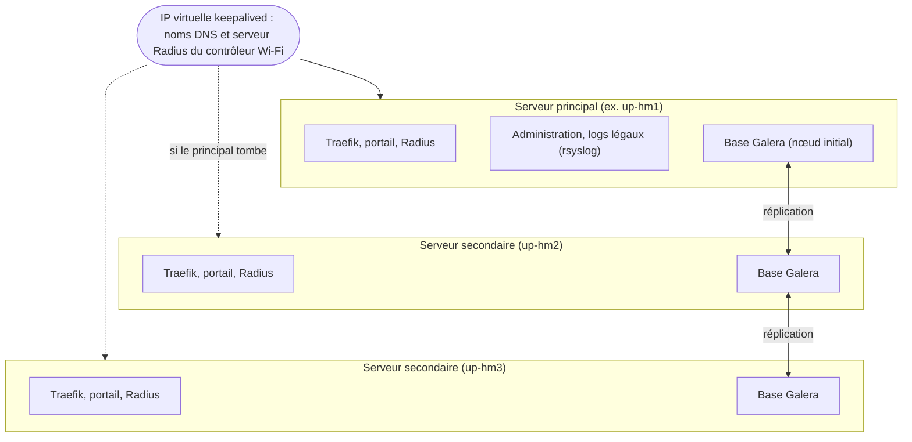

# Adipsys UP — Hotspot Manager en haute disponibilité

Hotspot Manager en haute disponibilité tourne sur 3 serveurs UP réunis en cluster : le service continue si l'un d'eux s'arrête. Ce document complète le [guide d'installation](guide-installation.md), à suivre d'abord pour préparer chacun des 3 serveurs. Le support Adipsys peut vous accompagner pour cette mise en place.

## Architecture



Radius, le portail et la base tournent sur les 3 serveurs. L'administration et les logs légaux ne tournent que sur le serveur principal : ils s'arrêtent tant qu'il est indisponible.

## Prérequis

Il faut 3 serveurs UP identiques, sur le même réseau local, qui se joignent librement entre eux.

- 3 serveurs installés avec le guide d'installation (ISO ou Debian existante), **sans lancer `up-setup`** : la haute disponibilité s'installe depuis Portainer.
- Chaque serveur dimensionné comme un serveur Hotspot Manager seul (au moins 4 vCPU, 4 Go de RAM, 100 Go SSD).
- Des noms de serveur différents (ex. : `up-hm1`, `up-hm2`, `up-hm3`) et des IP fixes.
- Pour une vraie tolérance aux pannes, des serveurs sur des hôtes physiques différents de l'hyperviseur.
- Une IP supplémentaire, libre sur le même réseau, pour l'adresse unique du service (section [Adresse unique](#adresse-unique--ip-virtuelle-et-noms-dns)).

### Flux entre les 3 serveurs

| Port | Usage |
|---|---|
| 2377/tcp | Gestion du cluster Swarm |
| 7946/tcp et udp | Communication entre les nœuds |
| 4789/udp | Réseau overlay (trafic entre conteneurs) |
| Protocole VRRP (112) | IP virtuelle keepalived |

Les flux vers Internet et les flux entrants des clients sont ceux du guide d'installation, sur chacun des 3 serveurs.

## Étape 1 : réunir les 3 serveurs en un cluster Swarm

À l'installation, chaque serveur crée son propre Swarm. Les 2 serveurs secondaires quittent le leur et rejoignent celui du serveur principal comme managers.

1. Sur le serveur principal (ex. `up-hm1`), affichez la commande d'ajout d'un manager :

   ```bash
   docker swarm join-token manager
   ```

2. Sur chacun des 2 autres serveurs, quittez le Swarm local puis lancez la commande affichée :

   ```bash
   docker swarm leave --force
   docker swarm join --token <jeton> <IP du serveur principal>:2377
   ```

3. Sur le serveur principal, vérifiez que les 3 nœuds sont *Ready*, avec un statut manager *Leader* ou *Reachable* :

   ```bash
   docker node ls
   ```

Le Portainer des serveurs secondaires n'est plus utile : travaillez uniquement dans celui du serveur principal (`https://<IP du principal>:9443`).

Cette opération se fait avant toute installation de produit : un serveur qui quitte son Swarm perd les stacks qui y tournaient.

## Étape 2 : installer Traefik et Hotspot Manager HA

Tout se fait dans le Portainer du serveur principal.

1. **Registre Adipsys** : *Registries* → *Add registry* → *Custom registry*, adresse `registry.adipsys.com`, avec les identifiants fournis par Adipsys.
2. **Certificat** : déposez le certificat et sa clé dans `/root/ssl_certificates/` et déclarez-les dans `/root/traefik/traefik.yaml` sur les 3 serveurs (Traefik tourne sur chacun). Le certificat de l'entreprise est conseillé en haute disponibilité.
3. **Traefik** : *App Templates* → *Traefik* → *Deploy the stack*.
4. **Hotspot Manager HA** : *App Templates* → *Hotspot Manager HA*. Remplissez le formulaire comme pour Hotspot Manager seul, plus 2 champs :

| Champ | Valeur |
|---|---|
| `HA_PRIMARY_NODE` | Nom du serveur principal, exactement comme affiché par `docker node ls` (ex. `up-hm1`) |
| `HA_DB_REPLICAS` | `1` pour l'installation |

Notez les mots de passe saisis dans votre coffre-fort : contrairement à `up-setup`, Portainer ne les enregistre pas ailleurs que dans la stack.

Avec `HA_DB_REPLICAS=1`, la base démarre sur 2 nœuds : le serveur principal et un secondaire. Attendez que tous les services de la stack soient démarrés (Portainer → *Stacks* → la stack) avant l'étape 3.

## Étape 3 : ajouter le 3e nœud de base de données

La base Galera ne peut pas démarrer directement sur 3 nœuds : le 3e la rejoint une fois les 2 premiers synchronisés.

1. Sur le serveur principal, vérifiez que la base compte 2 nœuds :

   ```bash
   docker exec $(docker ps -q -f name=hm-db-seed) sh -c 'mysql -uroot -p"$MYSQL_ROOT_PASSWORD" -e "SHOW STATUS LIKE \"wsrep_cluster_size\""'
   ```

   La valeur attendue est 2.

2. Dans Portainer, ouvrez la stack, passez `HA_DB_REPLICAS` à `2` dans ses variables, puis *Update the stack*.
3. Relancez la commande du point 1 : la valeur attendue est maintenant 3.

La valeur `HA_DB_REPLICAS=2` reste enregistrée dans la stack : les mises à jour suivantes gardent les 3 nœuds. Terminez ensuite comme pour un serveur seul : licence, mot de passe superadmin et SMTP (guide d'installation, *Après l'assistant*).

## Adresse unique : IP virtuelle et noms DNS

Les noms DNS du produit et le contrôleur Wi-Fi doivent viser une adresse qui reste joignable quand un serveur tombe : une IP virtuelle portée par keepalived, qui passe automatiquement sur un autre serveur.

1. Installez keepalived sur les 3 serveurs :

   ```bash
   apt-get install -y keepalived
   ```

2. Créez `/etc/keepalived/keepalived.conf` sur chaque serveur. Seules la ligne `priority` et la ligne `state` changent d'un serveur à l'autre :

   ```
   vrrp_script chk_docker {
       script "pgrep dockerd"
       interval 5
       weight 10
   }

   vrrp_instance VIP_HM {
       state MASTER              # BACKUP sur les 2 autres serveurs
       interface ens192          # carte réseau du serveur (ip -br a)
       virtual_router_id 22      # identique sur les 3, unique sur le réseau
       priority 150              # 150, 140, 130 selon le serveur
       advert_int 5
       virtual_ipaddress {
           192.0.2.10/24         # l'IP virtuelle
       }
       track_script {
           chk_docker
       }
   }
   ```

3. Démarrez le service et vérifiez que l'IP virtuelle apparaît sur le serveur principal :

   ```bash
   systemctl enable --now keepalived
   ip -br a
   ```

4. Faites pointer les noms DNS du produit vers l'IP virtuelle, et déclarez-la comme serveur Radius dans le contrôleur Wi-Fi.

Remplacez `ens192`, `192.0.2.10/24` et `virtual_router_id` par les valeurs de votre réseau.

## Exploitation

Le cluster supporte l'arrêt d'un serveur sur trois ; l'arrêt simultané de deux serveurs, ou des trois, demande une intervention.

### Mises à jour

- **Hotspot Manager** : lancez `up-update` sur le serveur principal, comme pour un serveur seul (guide d'installation, *Mettre à jour*). Faites un snapshot des 3 VM avant.
- **Portainer** : `portainer-update.sh` sur le serveur principal.
- **Système** : redémarrez les serveurs un par un, en attendant que le précédent soit revenu (`docker node ls` : *Ready*, base à 3 nœuds) avant de passer au suivant.

### Renouvellement du certificat

Le fichier `/root/traefik/traefik.yaml` existe sur chacun des 3 serveurs : déposez le nouveau certificat et modifiez ce fichier sur les 3, sinon le serveur oublié présente l'ancien certificat quand l'IP virtuelle passe sur lui. La procédure est celle du guide d'installation, section *Certificats HTTPS*.

### Sauvegardes

Chaque serveur sauvegarde chaque nuit les bases qui tournent sur lui, dans son propre `/backups/`. Copiez les sauvegardes des 3 serveurs hors du cluster.

### Panne d'un serveur

| Serveur arrêté | Effet | Que faire |
|---|---|---|
| Un secondaire | Portail, Radius et administration continuent ; la base tourne sur 2 nœuds | Redémarrer le serveur ; il rejoint le cluster seul |
| Le principal | L'IP virtuelle passe sur un secondaire ; portail et Radius continuent ; l'administration et les logs légaux, portés par le principal, sont indisponibles | Redémarrer le principal au plus vite |
| Deux ou trois serveurs | Service interrompu ; la base doit être redémarrée dans un ordre précis | Contacter le support Adipsys avant toute manipulation |

N'arrêtez jamais les 3 serveurs en même temps sans avoir prévenu le support.
